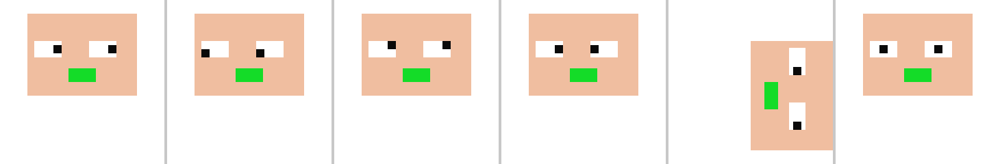

# CharCraft

Open-source live character animation in pure Rust: webcam face tracking, lip sync, and puppets built from PSD or AI
artwork. CharCraft opens Character Animator `.puppet` files and `.chproj` project folders, so existing puppets and
projects keep working.

Part of a family with [AniCraft](https://github.com/soof-golan/anicraft) (2D animation editor) on the shared
[anicraft-libs](https://github.com/soof-golan/anicraft-libs) engine, built on the open-source
[Craft](https://github.com/storytold) crates.

This is version 0.1.0, a pre-release; see [Known gaps](#known-gaps).

## Features

- **Files**: read and write `.puppet`; read and save `.chproj` project folders (scenes, puppets, media; the project is
  copied with every record kept, imported `.puppet` files are copied in, and the scene, takes and rig edits sit beside
  it); build a puppet from a `.psd` or `.ai` file, with rigging tags read from layer names (`+Head`, `Left Eye`,
  viseme names, `+Draggable` and so on, verbatim, including right-to-left names).
- **Project and workspace**: a Project panel (puppets in their folders, scene, audio, puppet properties; rename,
  duplicate, import, remove, save as `.puppet`), a start workspace (new project, recent files, recovery of autosaved
  work, starter gallery), Save, Save As, Revert, autosave, preferences, rebindable keyboard shortcuts, saved
  workspaces, and layer thumbnails in the rig tree.
- **Behaviors**: Face (with pose-to-pose), Head Turner, Lip Sync (microphone or scene audio), Eye Gaze, Auto Blink,
  Dragger, Physics (dangle, gravity, wind, collide, squash and stretch), Breathe, Walk (strut, prance, sneak, march,
  run, shuffle; pinned feet), Motion Trigger, Cycle Layers, Triggers and Transform, with per-scene overrides; ARAP
  mesh deformation for handles.
- **Lip sync**: speech audio (WAV, MP3, AAC, FLAC, Ogg) turned into the 13 viseme mouth shapes; puppets with only a
  Flappy Chin jaw get the jaw driven instead.
- **Live input**: webcam face tracking (camera and ONNX Runtime, built into the release packages) and microphone, as
  actors that own their devices. With no camera the app says so and offers the demo face as an explicit choice;
  `charcraft --face-file PHOTO` tracks a picture, an animated GIF or a folder of frames instead.
- **Rig, Record and Stream modes** in the app; scenes with recorded and performed takes.
- **Export**: a project scene or a performance to `MP4` (H.264 with AAC), `MOV` (ProRes 4444 with transparency), an
  animated `GIF`, a `PNG` sequence, or the sound alone as a `WAV`. File > Export has presets, range, size, frame rate and
  alpha options, and an export queue runs several in turn. WebM is not offered: it needs a VP9 encoder, none exists in
  pure Rust, and bundling libvpx would add a C build to every platform. Adobe Dynamic Link is proprietary and is not
  cloned; the alternative is the After Effects / Premiere package (PNG sequence, WAV, ProRes 4444 MOV and a
  `REEXPORT.txt` with the command that exports it again from the project).
- **MCP**: everything the UI does is a command; `charcraft-cli mcp` serves them headless or as a bridge to the running
  window, with real screenshots. See [docs/mcp.md](docs/mcp.md).

## Install

Download a package from the [releases page](https://github.com/soof-golan/charcraft/releases) and check it against
`SHA256SUMS`:

| Platform | Installer | Also |
| --- | --- | --- |
| Linux (x86_64, arm64) | `.AppImage` (`chmod +x`, then run it) or `.deb` (`sudo apt install ./charcraft_*.deb`) | `tar.gz` |
| macOS | `.dmg` for Apple silicon (`macos-arm64`) or Intel (`macos-x86_64`): drag CharCraft to Applications | `zip` |
| Windows (x86_64, arm64) | `-setup.exe`: Start-menu shortcuts, opens `.puppet` and `.chproj` files | `zip` |

The `.deb` and the Windows installer register `.puppet` and `.chproj` so a double click opens them in CharCraft; the
`.deb` also puts `charcraft` and `charcraft-cli` on the `PATH`. The macOS app asks for camera and microphone access.

The binaries are unsigned (a deliberate choice), so each OS asks for confirmation the first time:

- **macOS Gatekeeper**: "CharCraft cannot be opened". Open System Settings, Privacy & Security, scroll to the message
  about CharCraft and choose Open Anyway; or right-click the app, choose Open, then Open; or run
  `xattr -dr com.apple.quarantine /Applications/CharCraft.app`.
- **Windows SmartScreen**: "Windows protected your PC". Choose More info, then Run anyway.
- **Linux**: no prompt. An AppImage needs the executable bit and FUSE 2 (or run it with `--appimage-extract-and-run`).

Every package carries its own ONNX Runtime library (next to the program, or in the app's
`Contents/Frameworks`), so face tracking needs nothing installed; the two small face models are downloaded on first
use and checked against their SHA-256. `charcraft --check-live` runs that whole chain without a camera.

## Using it

```sh
charcraft MY.puppet                     # the app (rig mode); --mode record, --screenshot out.png
charcraft                               # the built-in demo puppet

charcraft-cli info MY.puppet            # layers, tags, behaviors, warnings
charcraft-cli render MY.puppet --viseme Ah -o ah.png
charcraft-cli lipsync speech.wav        # visemes as JSON
charcraft-cli animate MY.puppet --audio speech.wav -o out.mp4
charcraft-cli export "My Project" --scene Scene -o scene.mp4
charcraft-cli convert MY.puppet COPY.puppet
charcraft-cli mcp MY.puppet             # MCP server on stdin/stdout
```

## Screenshots

Rendered by the behavior tests from this repository's own synthetic puppet (no Adobe content is used anywhere in this
repository): a head turning to its extremes, nudged in each direction. Each has a written prediction next to it in
`crates/behaviors/tests/fixtures/visual/`.




## Fidelity

Checked against Character Animator puppets and a full project folder (two PSD news anchors, a recorded song, 14
takes): neutral renders match the artwork, mouth shapes open, necks stay attached, performances export to playable
video. Those files are never committed; tests that need them read `ANICRAFT_SAMPLES` and are skipped when it is unset.

## Building

```sh
cargo build -p charcraft-app -p charcraft-cli       # demo face only
cargo build -p charcraft-app --features live        # webcam and ONNX Runtime, as in the release packages
cargo test --workspace
```

Rust 1.99.1 is pinned in `rust-toolchain.toml`. On Linux install the development packages that
`.github/workflows/ci.yml` lists (ALSA, udev, xkbcommon, Wayland, X11, GL, GTK 3, fontconfig), and `libclang` for the
camera backend (its V4L2 bindings are generated with bindgen); `libv4l-dev` is not required. The engine crates come
from `anicraft-libs`, pinned by git rev in `Cargo.toml`.

Face tracking (`charcraft-tracking`) has optional features: `camera` (nokhwa), `onnx` (ONNX Runtime from the binaries
its build downloads; needs glibc 2.38+ on Linux, so Ubuntu 24.04 or newer) and `onnx-dynamic` (loads `libonnxruntime`
at run time, the mode of the `live` build: from `ORT_DYLIB_PATH` when set, else the copy next to the program or in
`Contents/Frameworks`; works on any Linux with glibc 2.27 or newer, Jetson and apps that ship their own runtime). Model
weights are
downloaded into the platform cache on first use and verified by SHA-256; `cargo run -p charcraft-tracking --features
onnx-dynamic --example probe -- PHOTO.jpg OVERLAY.png` runs them on a photo.

## Known gaps

None at present.

## License

Dual-licensed under [MIT](LICENSE-MIT) or [BSD-3-Clause](LICENSE-BSD-3-Clause), at your option. Third-party code
and assets are listed in [ATTRIBUTION.md](ATTRIBUTION.md).

See [ARCHITECTURE.md](ARCHITECTURE.md) for the crate map and [AGENTS.md](AGENTS.md) for the rules every change
follows.

This project is not affiliated with or endorsed by Adobe. Adobe and Character Animator are trademarks of Adobe Inc.;
they are named here only to describe file compatibility.
